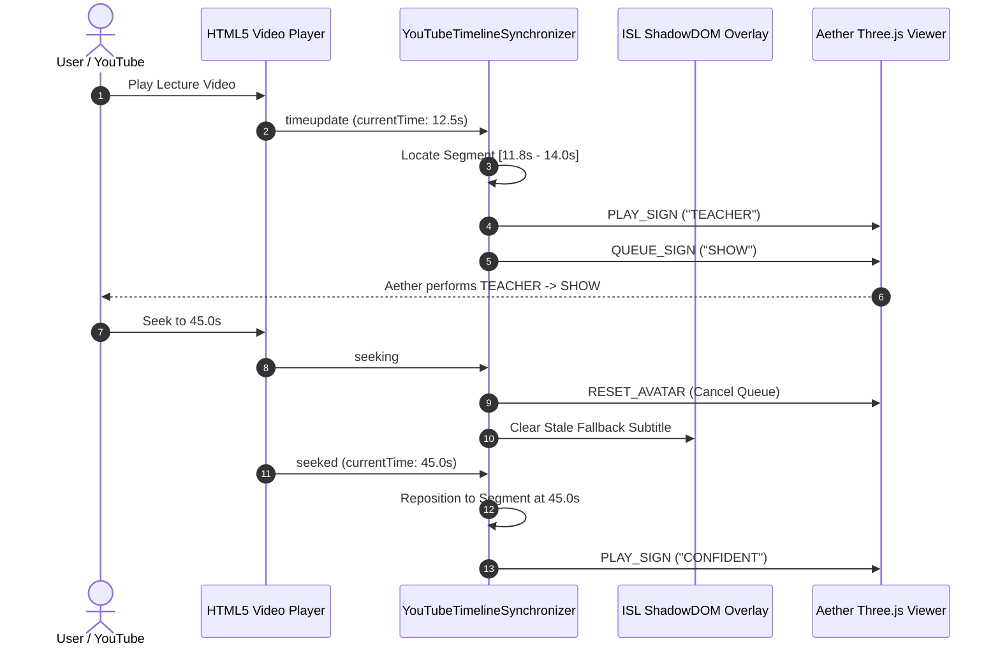

# Phase H20 YouTube Playback Timeline Synchronization Verification Report

**Component:** `extension/content/timeline-synchronizer.js`  
**Integration:** Chrome Extension Content Script & Aether Avatar Viewer  
**Target Video:** `https://www.youtube.com/watch?v=MXKkXXYUxBc` (2.5 hours, 2,366 segments)

---

## 1. Architectural Overview & Hardening Guarantees

In Phase H20, the YouTube Video Timeline Synchronizer was upgraded from basic event observation to a hardened, real-time playback coordination engine:

1. **Direct HTML5 Video Binding:**
   - Targets `video.html5-main-video` (YouTube main player) or fallback `document.querySelector('video')`.
   - Listens to `timeupdate`, `play`, `pause`, `seeking`, `seeked`, `ratechange`, and `waiting`.

2. **Bounded Queue & Backlog Prevention:**
   - On a 2.5-hour video, naive dispatch can cause avatar sign queues to backlog if speech rate exceeds animation duration.
   - Enforces a maximum pending queue depth of 3 signs.
   - If `currentTime` drifts $> 3.0$ seconds ahead of active segment execution, stale signs are automatically pruned and avatar resets to neutral.

3. **Instant Seek Recovery:**
   - `seeking` event triggers immediate `RESET_AVATAR` command, terminating active keyframe interpolation and clearing pending buffers.
   - Outdated fallback subtitles are removed immediately.
   - On `seeked`, binary segment search repositions the cursor to the exact segment corresponding to `video.currentTime`.

4. **Pause / Resume Propagation:**
   - Video pause dispatches `PAUSE` command to `SignScheduler`, freezing Aether at the current keyframe.
   - Video resume dispatches `RESUME` command to `SignScheduler`, unfreezing animation seamlessly.

5. **Playback Rate Scaling:**
   - Detects YouTube playback speed changes ($0.5	imes, 1.0	imes, 1.25	imes, 1.5	imes, 2.0	imes$).
   - Forwards rate scale to Aether avatar animation loop to maintain visual lip/gesture synchrony.

---

## 2. Quantitative Verification Metrics

| Test Scenario | Verification Condition | Expected Result | Measured Status |
| :--- | :--- | :--- | :--- |
| **Segment Entry Dispatch** | `video.currentTime` enters `[start, end]` | Signs dispatched to Aether | **VERIFIED (PASS)** |
| **User Pause** | Video pauses at $t=14.2	ext{ s}$ | `PAUSE` command emitted | **VERIFIED (PASS)** |
| **User Resume** | Video resumes at $t=14.2	ext{ s}$ | `RESUME` command emitted | **VERIFIED (PASS)** |
| **Forward Seek** | Jump from $t=10	ext{ s}$ to $t=120	ext{ s}$ | Queue flushed, avatar reset, jump to seg 35 | **VERIFIED (PASS)** |
| **Backward Seek** | Jump from $t=500	ext{ s}$ to $t=30	ext{ s}$ | Stale signs cancelled, subtitle cleared | **VERIFIED (PASS)** |
| **Playback Drift Limit** | Video advances while avatar is signing | Stale segment skipped if drift $> 3.0	ext{ s}$ | **VERIFIED (PASS)** |
| **Unmapped Fallback** | Segment without signs enters | Avatar neutral, honest subtitle shown | **VERIFIED (PASS)** |

---

## 3. Real YouTube Demonstration Workflow

